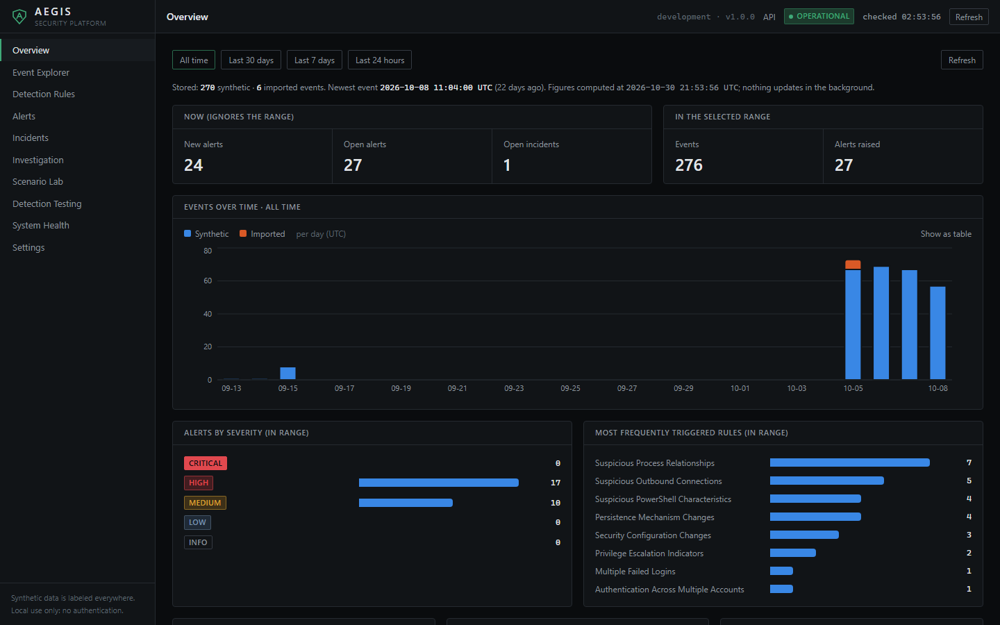
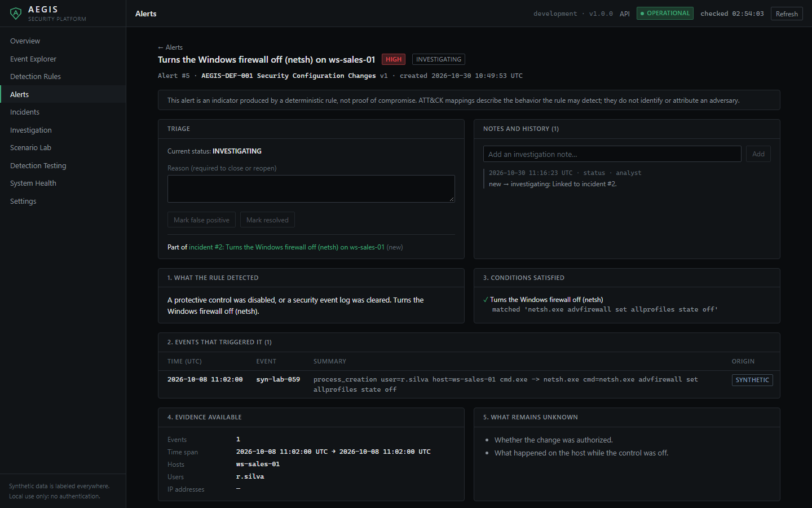
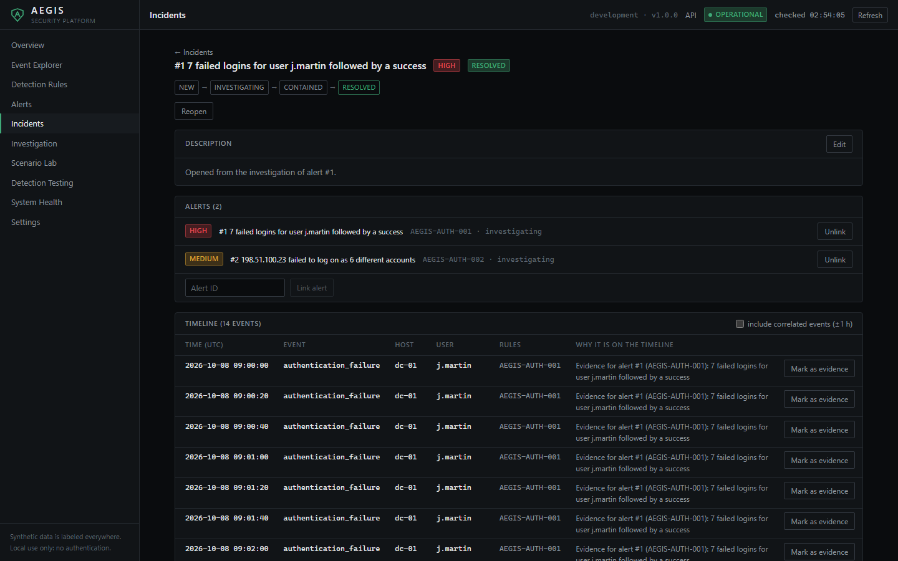
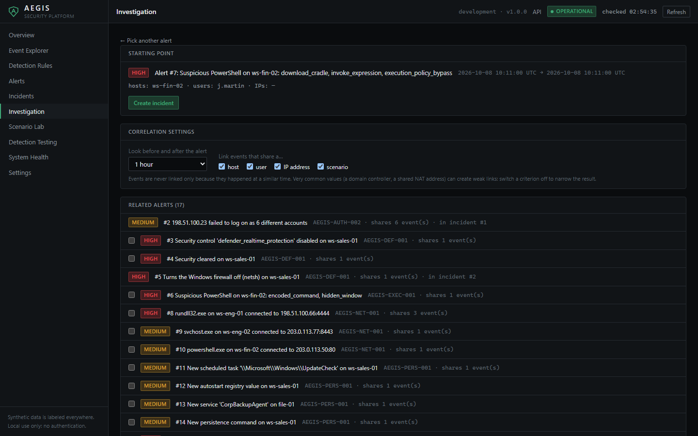
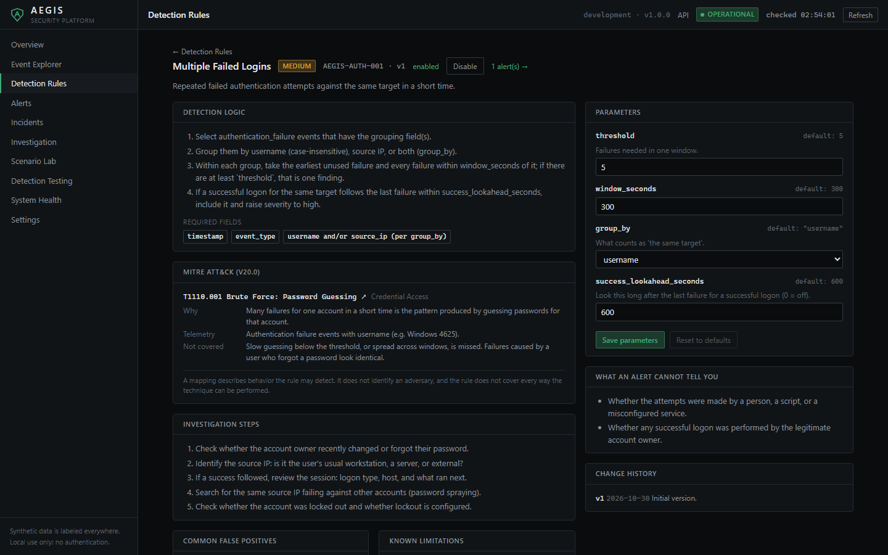
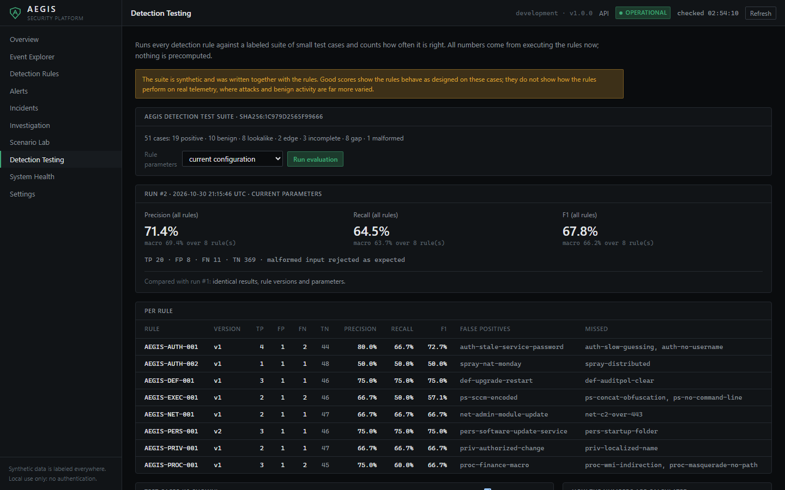
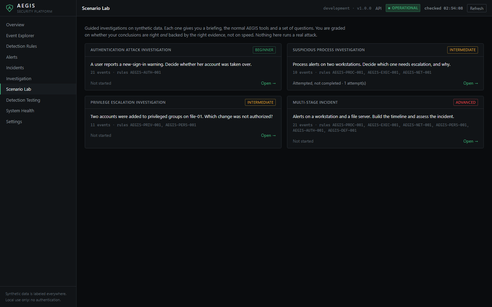
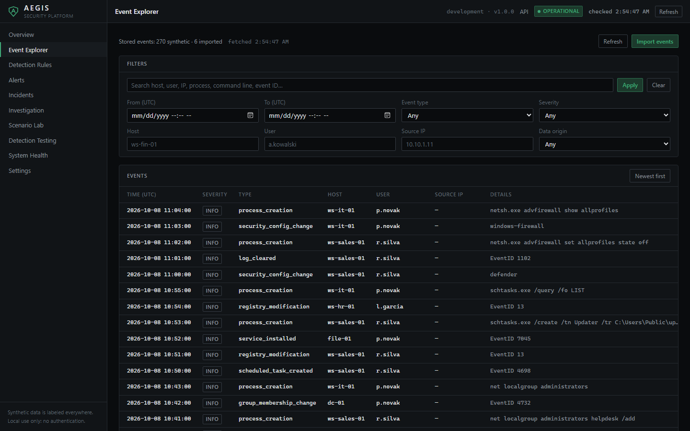
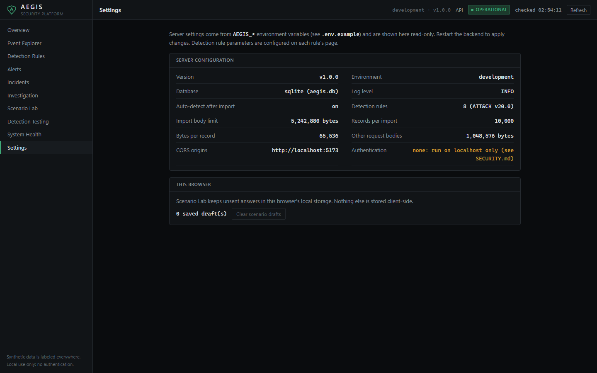
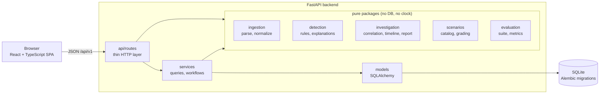

# AEGIS Security Platform

**Detect. Investigate. Defend.**

AEGIS is a defensive security platform for security event analysis,
rule-based threat detection, incident investigation and detection
engineering. It turns raw security events into explainable detections and
structured investigations, and lets analysts practise incident response on
synthetic data in a safe lab.



AEGIS is a learning and portfolio project. It is **not** an enterprise SIEM,
it has no real-world validation, and it has no authentication, so it must
run on localhost only (see [SECURITY.md](SECURITY.md)). All bundled data is
synthetic and labeled as such everywhere in the UI.

## Contents

- [Features](#features)
- [Screenshots](#screenshots)
- [Architecture](#architecture)
- [Technology stack](#technology-stack)
- [Local development](#local-development)
- [Docker](#docker)
- [Tests and checks](#tests-and-checks)
- [Demo dataset and walkthrough](#demo-dataset-and-walkthrough)
- [Known limitations](#known-limitations)
- [Roadmap](#roadmap)
- [License](#license)

## Features

**Event pipeline**

- Import security events as JSON Lines or JSON, through the UI or
  `POST /api/v1/ingestion/batches` ([format](docs/EVENT_FORMAT.md)).
- Normalization into one schema: UTC timestamps, Sysmon and Windows Security
  field aliases, canonical IP addresses, `DOMAIN\user` splitting. The
  original record is always kept.
- Per-record validation: a bad record is rejected with its line number and
  reason and never blocks the good ones. Re-importing is safe
  (de-duplication by stable event ID).
- **Event Explorer** with time, type, severity, host, user, IP and origin
  filters, text search, shareable filter URLs and a raw-vs-normalized view.

**Detection engine**

- Eight deterministic, explainable rules: failed logins, password spraying,
  suspicious PowerShell, privilege escalation, suspicious process
  relationships, persistence, suspicious outbound connections and security
  configuration changes ([catalog](docs/DETECTION_RULES.md), generated from
  the code).
- Each rule documents its logic, required fields, false positives,
  limitations, investigation steps and version history. ATT&CK mappings are
  verified against ATT&CK v20.0 and state what they do *not* cover.
- Tunable, validated parameters per rule; rules can be disabled. Detection
  runs after each import and on demand, and never duplicates an alert.
- Every alert carries a structured explanation built from its own evidence:
  what was detected, which events and conditions, what is known and unknown,
  next steps and likely false positives. No language model is involved.

**Investigation and incident response**

- Alert triage with validated status transitions, required reasons for
  closing or reopening, notes and full history.
- **Explainable correlation:** events sharing a host, user, IP address or
  scenario with an alert's evidence, each with the reason it is linked.
  Time proximity alone never links events.
- **Incidents** (new → investigating → contained → resolved) with linked
  alerts, evidence, notes, hypotheses labeled as unverified, an
  append-only history and a timeline. Resolving requires a verdict and a
  written assessment.
- Downloadable Markdown incident report with untrusted text escaped.

**Overview dashboard**

- Figures computed from the database at request time, ranges anchored to
  the real current time, data freshness shown, "now" metrics kept apart from
  range metrics. Every figure links to the list behind it; the chart has a
  table view. No simulated live telemetry.

**Scenario Lab**

- Four guided investigations from beginner to advanced: account takeover,
  a malicious macro next to a benign one, privilege escalation next to an
  authorized change, and a multi-stage intrusion.
- **Evidence-based grading:** conclusions must be right *and* backed by the
  key events; citing a benign lookalike costs points. Answers never reach
  the browser before the attempt is closed. Time and hints are not scored.

**Detection evaluation**

- A labeled suite of 51 cases (positives, benign, lookalikes, edge cases,
  incomplete telemetry, known gaps, malformed input). Labels describe
  reality, not what the rules do.
- Per-rule TP/FP/FN/TN, precision, recall and F1 (undefined values shown as
  "n/a"), misclassified cases, and comparison with the previous run to
  measure tuning. Default parameters: precision 71.4%, recall 64.5%, F1
  67.8%, on synthetic data ([method and limits](docs/DETECTION_EVALUATION.md)).
- The suite found a real bug (deleted Run keys reported as persistence),
  fixed in AEGIS-PERS-001 v2 with a regression test.

**Operations**

- System Health (database, schema revision, stored data) and a read-only
  Settings page.
- Request limits, a strict Content-Security-Policy, an explicit CORS
  allow-list and a uniform error envelope that never leaks tracebacks
  ([SECURITY.md](SECURITY.md)).

## Screenshots

Taken from the development database used while building AEGIS (the demo
data plus Scenario Lab runs), so counts differ from a fresh [demo](docs/DEMO.md).

| | |
| --- | --- |
|  Alert explanation |  Resolved incident with timeline |
|  Correlation with reasons |  Rule documentation and parameters |
|  Detection evaluation |  Scenario Lab |
|  Event Explorer |  Settings |

## Architecture

A modular monolith: one backend process, one SQLite database, one
single-page frontend. Nothing in the intended scale (thousands of events,
one analyst) justifies queues, caches or services.



Routes stay thin, services hold the workflow, and the analytical logic lives
in pure packages that are tested by passing data in directly. Details and
design decisions: [ARCHITECTURE.md](ARCHITECTURE.md).

## Technology stack

| Area | Choice |
| --- | --- |
| Backend | Python 3.12, FastAPI, Pydantic v2, SQLAlchemy 2.1, Alembic, SQLite |
| Frontend | React 19, TypeScript 6, Vite 8, Tailwind CSS 4, React Router 7, Recharts 3 |
| Testing | pytest, HTTPX (via FastAPI `TestClient`), Vitest, React Testing Library |
| Quality | Ruff (lint + format), mypy `--strict`, ESLint, `tsc` |
| Delivery | Docker / Docker Compose (unverified, see below), GitHub Actions, OpenAPI |

Exact dependency versions are pinned in `backend/requirements*.txt` and
`frontend/package-lock.json`.

## Local development

Prerequisites: **Python 3.12+** and **Node.js 22.12+** (developed with
Python 3.12 and Node 26 on Windows 11).

### Backend

```bash
cd backend
python -m venv .venv
# Windows: .venv\Scripts\activate    macOS/Linux: source .venv/bin/activate
pip install -r requirements-dev.txt
alembic upgrade head                 # creates backend/data/aegis.db
uvicorn app.main:create_app --factory --reload
```

The API listens on http://127.0.0.1:8000, with interactive OpenAPI docs at
http://127.0.0.1:8000/docs.

### Frontend

In a second terminal:

```bash
cd frontend
npm ci
npm run dev
```

Open http://localhost:5173. The dev server forwards `/api` to the backend,
so no CORS configuration is needed in development.

### Configuration

All settings are optional environment variables prefixed with `AEGIS_`;
see [.env.example](.env.example). The **Settings** page shows the values
the running server uses.

### Troubleshooting

- **`[WinError 10013]` or `address already in use`.** Another process
  listens on port 8000, often an earlier backend. Find it with
  `netstat -ano | findstr :8000` (Windows) or `lsof -i :8000`
  (macOS/Linux), or start AEGIS on another port (`--port 8001`) and set
  `AEGIS_BACKEND_URL=http://127.0.0.1:8001` for the frontend dev server.
- **`Port 5173 is in use`.** The Vite port is fixed so the proxy and CORS
  settings stay valid. Stop the other process.
- **`npm` is not recognized.** Open a new terminal after installing Node.js.
- **Start over with an empty database:** stop the backend, delete
  `backend/data/aegis.db`, run `alembic upgrade head`.

## Docker

> **Unverified.** `docker-compose.yml` and both Dockerfiles were written for
> this release but have **not been built or run**: Docker was not available
> on the development machine. They follow the local setup above, but treat
> them as a starting point and please report problems.

```bash
docker compose up --build
```

Then open http://127.0.0.1:8080. The intended setup: the backend applies
migrations on start and stores SQLite in the `aegis-data` volume; nginx
serves the built frontend and proxies `/api` to the backend, so the browser
talks to one origin; the port is published on `127.0.0.1` only, because
AEGIS has no authentication.

## Tests and checks

```bash
cd backend
pytest                                   # 390 tests: unit, API, migrations, security
ruff check . && ruff format --check .
mypy app tests
```

```bash
cd frontend
npm test                                 # 64 tests: Vitest + React Testing Library
npm run lint
npm run typecheck
npm run build
```

Backend tests run against real SQLite databases built by the real
migrations. For this release, all of the above were run from a fresh clone
on Windows 11 (Python 3.12, Node 26) and passed. The GitHub Actions
workflow (`.github/workflows/ci.yml`) runs the same commands but has not yet
run on GitHub.

## Demo dataset and walkthrough

Two deterministic synthetic datasets ship with the backend and load with one
click from the Overview or **Import events**:

| Dataset | Events | What it contains | Expected alerts |
| --- | ---: | --- | ---: |
| Baseline office activity | 203 | Three ordinary office days, including routine admin activity | 0 |
| Detection lab (labeled) | 57 | A positive case and a benign lookalike for every rule | 19 |

The Scenario Lab adds its own events when a scenario is started.

**[docs/DEMO.md](docs/DEMO.md)** is a 15-minute walkthrough from an empty
database: import with malformed records, an alert explanation, rule tuning,
correlation, a full incident from creation to report, a Scenario Lab
investigation and a detection evaluation, with the numbers you should see at
each step. A short version:

1. Load the baseline dataset, then import
   [docs/examples/malformed-events.jsonl](docs/examples/malformed-events.jsonl):
   1 record stored, 7 rejected with reasons.
2. Load the detection lab: 19 alerts. Open *7 failed logins for user
   j.martin followed by a success* and read its explanation.
3. **Investigation** on that alert → create an incident with the related
   spraying alert → move it through to *resolved* → preview the report.
4. **Detection Testing → Run evaluation**; raise a threshold and compare.

## Known limitations

- **No authentication.** Anyone who can reach the API can use it. The
  `author` on notes and history is a label, not a verified identity.
- The rules, the synthetic datasets and the evaluation suite were written
  together. Good results on them do not show how the rules would perform on
  real telemetry ([details](docs/DETECTION_EVALUATION.md#what-these-numbers-do-not-show)).
- Import accepts JSON / JSON Lines only: no native `.evtx`, syslog or CEF.
- Detection re-evaluates all stored events on each run, and text search uses
  SQL `LIKE`. Both are fine for tens of thousands of events, not for SIEM
  volumes.
- Correlation has no weighting: very common values (a domain controller, a
  shared NAT address) create many weak links. Criteria can be switched off.
- Scenario Lab grades conclusions and cited evidence; written reasoning is
  stored but not graded.
- No rate limiting; SQLite is not encrypted at rest.
- Docker files and the CI workflow have not been run (see above).
- Backend tests print a Starlette deprecation warning about `httpx`; it does
  not affect results.

## Roadmap

Ideas, not commitments, roughly in order of value:

- Authentication and per-user audit trail, so AEGIS could run beyond
  localhost.
- Native `.evtx` and syslog/CEF parsers.
- Incremental detection and a full-text index for larger datasets.
- Sigma rule import, mapped onto the same explanation model.
- Weighted correlation that discounts very common hosts and addresses.
- More scenarios and evaluation cases, including ones written independently
  of the rules.

## Contributing and security

See [CONTRIBUTING.md](CONTRIBUTING.md) for checks, ground rules and the
checklist for changing a detection rule. Report vulnerabilities privately as
described in [SECURITY.md](SECURITY.md).

## License

[MIT](LICENSE) © 2026 Rootvandal.
